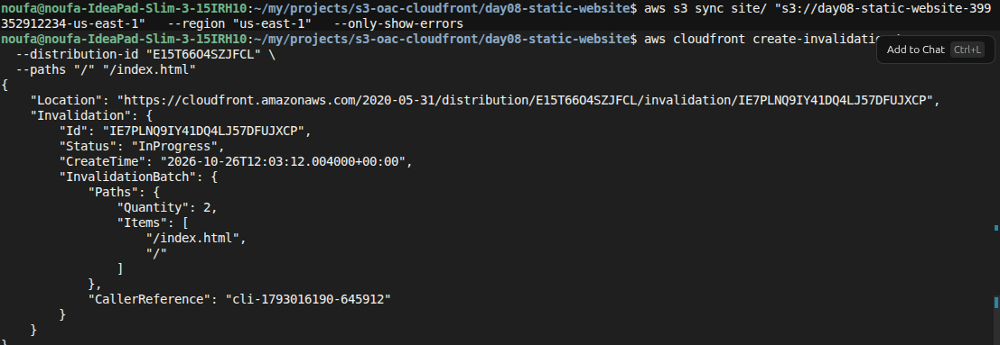
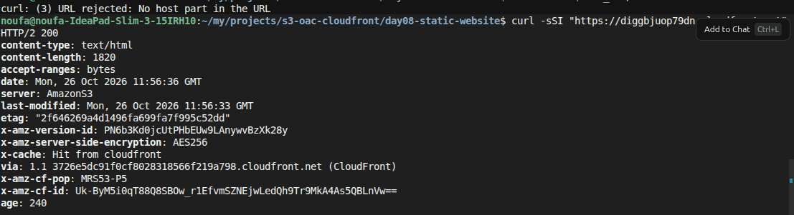

## Test 1 — Website update and cache invalidation

**Goal:** Confirm that after content changes in S3, a CloudFront invalidation forces edge locations to fetch the new objects.

**Steps**
1. Change a visible string in `site/index.html` (for example the `<h1>` or eyebrow text).
2. Upload the updated site to the private bucket:

```bash
aws s3 sync site/ "s3://$BUCKET" \
  --region "$REGION" \
  --only-show-errors
```

3. Invalidate the cached paths so CloudFront does not keep serving the old HTML:

```bash
aws cloudfront create-invalidation \
  --distribution-id "$DIST_ID" \
  --paths "/" "/index.html"
```

4. Wait until the invalidation status is `Completed`, then reload `$SITE_URL` in the browser.

**Expected result**
- Sync finishes with no errors.
- `create-invalidation` returns an invalidation ID with status `InProgress`, then later `Completed`.
- The browser shows the updated heading/text after the invalidation finishes.



---

## Test 2 — Inspect CloudFront caching headers

**Goal:** Verify the site is served through CloudFront (not a public S3 URL) and that responses include cache-related headers.

**Steps**
1. Send a headers-only request to the distribution URL:

```bash
curl -sSI "$SITE_URL/"
```

2. Optionally run the same command again after a short wait and compare `x-cache` / `age`.

**Expected result**
- HTTP status is `200`.
- `server` / origin signals show Amazon S3 behind CloudFront.
- Headers such as `x-cache`, `via`, `x-amz-cf-pop`, and `age` are present.
- A later request may report `Hit from cloudfront` with a non-zero `age`, showing the object was served from the edge cache.


